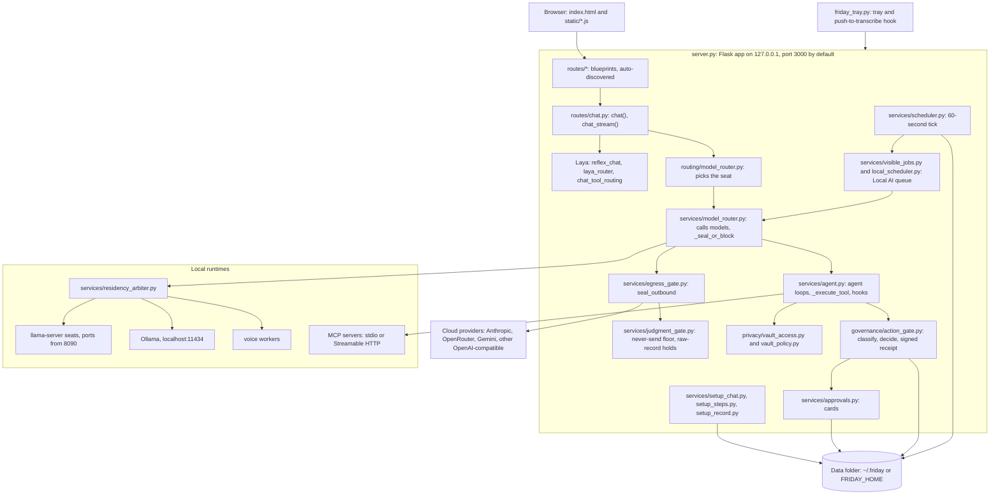
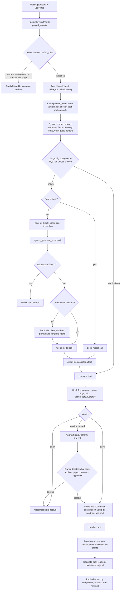

# Architecture diagrams

> Last checked against the code on 2026-10-17 (origin/main). Paths are relative
> to `src/agent_friday/`. The prose that goes with these diagrams is in
> [ARCHITECTURE.md](../../ARCHITECTURE.md) and
> [overview.md](overview.md). When a diagram and the code disagree, the code
> is right.

## 1. Component layout

Processes, the main server-side subsystems and where state is kept.

## 2. A chat turn through the gates

One typed turn on `/api/chat` (or `/api/chat/stream`, which runs the same
`chat()` on a worker thread). Optional or trial-mode steps are marked.

